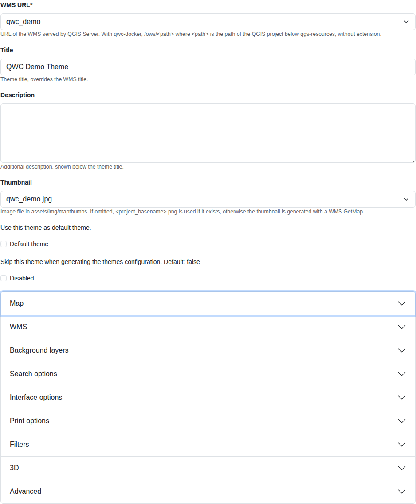
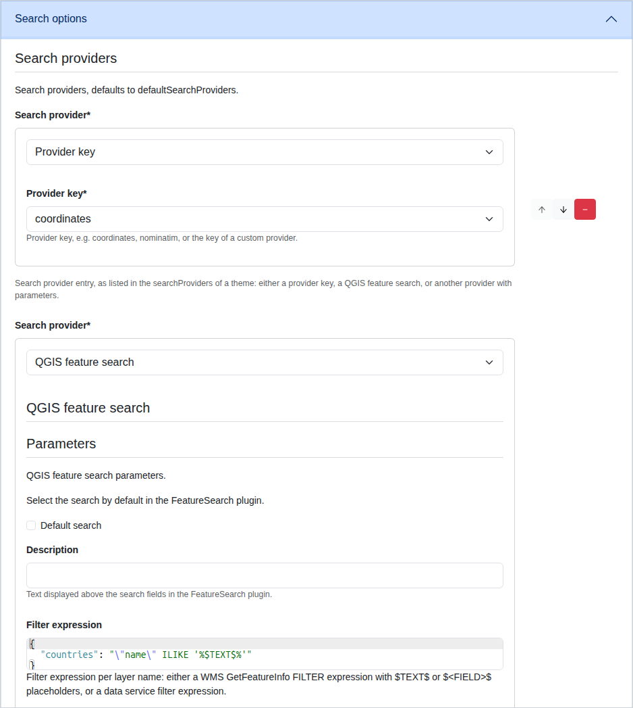
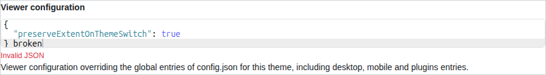
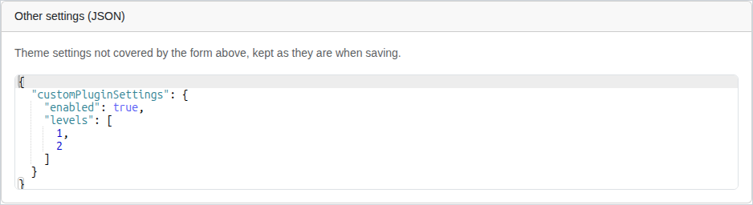

[](https://github.com/qwc-services/qwc-admin-gui/actions)
[](https://hub.docker.com/r/sourcepole/qwc-admin-gui)

QWC Admin GUI
=============

Web backend for administration of QWC Services.

* Manage users, groups and roles
* Define resources and assign permissions
* Define registrable groups and manage group registration requests

See also [Managing Users, Resources and Permissions](https://qwc-services.github.io/master/configuration/ResourcesPermissions/).

Configuration
-------------

The static config files are stored as JSON files in `$CONFIG_PATH` with subdirectories for each tenant,
e.g. `$CONFIG_PATH/default/*.json`. The default tenant name is `default`.

### JSON config

* [JSON schema](schemas/qwc-admin-gui.json)
* File location: `$CONFIG_PATH/<tenant>/adminGuiConfig.json`

Example:
```json
{
  "$schema": "https://raw.githubusercontent.com/qwc-services/qwc-admin-gui/master/schemas/qwc-admin-gui.json",
  "service": "admin-gui",
  "config": {
    "db_url": "postgresql:///?service=qwc_configdb",
    "config_generator_service_url": "http://qwc-config-service:9090",
    "totp_enabled": false,
    "user_info_fields": [],
    "proxy_url_whitelist": [],
    "proxy_timeout": 60
  }
}
```

See the [schema definition](schemas/qwc-admin-gui.json) for the full set of supported config variables.

### Environment variables

Config options in the config file can be overridden by equivalent uppercase environment variables.

In addition, the following environment variables are supported:

| Name                         | Default       | Description                                                                               |
|------------------------------|---------------|-------------------------------------------------------------------------------------------|
| `GROUP_REGISTRATION_ENABLED` | `True`        | Whether to allow registrable groups and group registration requests via [Registration GUI](https://github.com/qwc-services/qwc-registration-gui). |
| `IDLE_TIMEOUT`               | `0`           | Idle timeout after which to automatically log out (`0` disables automatic logout).        |
| `SKIP_LOGIN`                 | `False`       | Whether to skip redirect to the `auth_service_url` is user is not authenticated (for development). |
| `DEFAULT_LOCALE`             | `en`          | Admin GUI language (see [src/translations](src/translations) for available languages), strings missing in its translations are shown in English. |
| `JSON_SCHEMAS_PATH`          | `/tmp/`       | Directory with the qwc2 themes configuration schemas used by the theme form, downloaded from the URLs in [src/schema-versions.json](src/schema-versions.json) if missing. |
| `MAIL_SERVER`                | `localhost`   | Mailer setup, see [Flask-Mail](https://flask-mail.readthedocs.io/en/latest/#configuring). |
| `MAIL_PORT`                  | `25`          | Mailer setup, see [Flask-Mail](https://flask-mail.readthedocs.io/en/latest/#configuring). |
| `MAIL_USE_TLS`               | `False`       | Mailer setup, see [Flask-Mail](https://flask-mail.readthedocs.io/en/latest/#configuring). |
| `MAIL_USE_SSL`               | `False`       | Mailer setup, see [Flask-Mail](https://flask-mail.readthedocs.io/en/latest/#configuring). |
| `MAIL_DEBUG`                 | `app.debug`   | Mailer setup, see [Flask-Mail](https://flask-mail.readthedocs.io/en/latest/#configuring). |
| `MAIL_USERNAME`              | `None`        | Mailer setup, see [Flask-Mail](https://flask-mail.readthedocs.io/en/latest/#configuring). |
| `MAIL_PASSWORD`              | `None`        | Mailer setup, see [Flask-Mail](https://flask-mail.readthedocs.io/en/latest/#configuring). |
| `MAIL_DEFAULT_SENDER`        | `None`        | Mailer setup, see [Flask-Mail](https://flask-mail.readthedocs.io/en/latest/#configuring). |
| `MAIL_MAX_EMAILS`            | `None`        | Mailer setup, see [Flask-Mail](https://flask-mail.readthedocs.io/en/latest/#configuring). |
| `MAIL_SUPPRESS_SEND`         | `app.testing` | Mailer setup, see [Flask-Mail](https://flask-mail.readthedocs.io/en/latest/#configuring). |
| `MAIL_ASCII_ATTACHMENTS`     | `False`       | Mailer setup, see [Flask-Mail](https://flask-mail.readthedocs.io/en/latest/#configuring). |


### Two-factor authentication

If two factor authentication is enabled in the [DB-Auth service](https://github.com/qwc-services/qwc-db-auth), set `totp_enabled` to `true` to show the TOTP fields in the user form.

### Additional user fields

Additional user fields are saved in the table `qwc_config.user_infos` with a a one-to-one relation to `qwc_config.users` via the `user_id` foreign key.
To add custom user fields, add new columns to your `qwc_config.user_infos` table and set your `user_info_fields` to a JSON with the following structure:

```json
[
  {
    "title": "<field title>",
    "name": "<column name>",
    "type": "<field type (text|textarea|integer|list, default: text)>",
    "values": "<field values in dropdown list ([(value1, label1), (value2, label2), ...]|[value1, value2, ...])>",
    "required" "<whether field is required (true|false, default: false)>"
  }
]
```

These fields are then added to the user form.

Example:

```sql
ALTER TABLE qwc_config.user_infos ADD COLUMN surname character varying NOT NULL;
ALTER TABLE qwc_config.user_infos ADD COLUMN first_name character varying NOT NULL;
```

```json
"user_info_fields": [{"title": "Surname", "name": "surname", "type": "text", "required": true}, {"title": "First name", "name": "first_name", "type": "text", "required": true}]
```

### Invitations

You can send invitation mails to users from the `Users` page. You will need to configure the mailer using the `MAIL_*` environment variables documented above. You can customize the invitation mail by setting the `application_name` and `application_url` JSON config variables, or provide a fully custom template by replacing the [`invite_email_body.<lang>.txt`](src/templates/users) files. If you are running `qwc-admin-gui` in Docker, you can mount your custom templates to `/srv/qwc_service/templates/users/`.

### Translations

Translation strings are stored in a JSON file for each locale in `translations/<locale>.json` (e.g. `en.json`). Add any new languages as new JSON files. You can use the [updateTranslations.py](updateTranslations.py) helper script to update the translation files with the message ids from the source files. `en.json` lists all of them; the other files only keep the translated ones, since the admin gui shows the missing strings in English. It also adds the titles and descriptions of the theme form schemas, read from `JSON_SCHEMAS_PATH` or downloaded, so run it in the project environment: `uv run updateTranslations.py`.

Set the `DEFAULT_LOCALE` environment variable to choose the locale for the user notification mails (default: `en`).

### Solr search index update

If using a Solr search service, the Solr search index of a tenant may be updated via a button on the main page. This can be activated by adding the following configuration options to the Admin GUI service config:
```json
{
  "config": {
    "solr_service_url": "http://qwc-solr:8983/solr/gdi/",
    "solr_tenant_dih": "dih_geodata",
    "solr_tenant_dih_config_file": "/solr/config-in/dih_geodata_config.xml",
    "solr_config_path": "/solr/config-out",
    "solr_update_check_wait": 5,
    "solr_update_check_max_retries": 10
  }
}
```

* `solr_service_url`: Solr Service base URL for collection
* `solr_tenant_dih`: Solr DataImportHandler for the tenant
* `solr_tenant_dih_config_file` (optional): Path to source DataImportHandler config file for the tenant
* `solr_config_path` (optional): Path to Solr configs (**Note:** requires write permissions for DataImportHandler config files)
* `solr_update_check_wait` (optional): Wait time in seconds for checks during Solr index update (default: `5`s)
* `solr_update_check_max_retries` (optional): Max number of retries for checks during Solr index update (default: `10`)

If both `solr_tenant_dih_config_file` and `solr_config_path` are set, the tenant config file is first copied to the Solr configs dir before updating the Solr search index.

Example volumes for `qwc-docker` environment and above service config:
```yaml
services:
  qwc-admin-gui:
    # ...
    volumes:
      # ...
      # Solr configs
      - ./volumes/solr/configsets/gdi/conf:/solr/config-in:ro
      - ./volumes/solr/data/gdi/conf:/solr/config-out
```

### Plugins

The admin gui is extendable through plugins, which reside in the `plugins` folder. To enable them, list them in `plugins` in the admin gui configuration. See the JSON schema for details, and for configuration parameters which may be required by plugins shipped by default with `qwc-admin-gui`.

#### Themes plugin

The `themes` plugin adds the Themes page, which edits the theme definitions of `themesConfig.json` in a form instead of the JSON file.

##### Setup

Enable the plugin in the `config` block of the `adminGui` service in `tenantConfig.json`. A sample configuration is as follows:

```json
"plugins": ["themes"],
"input_config_path": "/srv/qwc_service/config-in",
"qwc2_path": "/qwc2",
"qgs_resources_path": "/qgs-resources",
"info_templates_path": "/info_templates",
"ows_prefix": "/ows",
"default_qgis_server_url": "http://qwc-qgis-server/ows/"
```

Mount the directories these paths point to in the `qwc-admin-gui` container, for example:

```yaml
- ./volumes/config-in:/srv/qwc_service/config-in:rw
- ./volumes/qwc2:/qwc2
- ./volumes/qgs-resources:/qgs-resources
- ./volumes/info-templates:/info_templates
```

The theme form schemas are downloaded into `JSON_SCHEMAS_PATH` when the image is built, from the URLs in `src/schema-versions.json` (qwc2 `master`). A schema file missing at runtime is downloaded again. To use other schema files, mount a directory holding them at `JSON_SCHEMAS_PATH`.

##### Form layout



The form is generated from the [qwc2 theme schemas](https://github.com/qgis/qwc2/tree/master/schemas), which also produce the theme definition table of the [manual theme configuration](https://qwc-services.github.io/master/configuration/ThemesConfiguration/#manual-theme-configuration). It covers every setting these schemas define:

* The general settings come first: WMS URL, title, description, thumbnail, default theme and disabled.
* The other settings are grouped in collapsible sections: Map (expanded), WMS, Background layers, Search options, Interface options, Print options, Filters, 3D and Advanced.
* Required settings are marked with `*`. Each field shows the description from the schema, followed by the viewer default where there is one.
* A setting added to the qwc2 schemas shows up below the general settings once the Docker image is rebuilt.
* Titles and descriptions follow the Admin GUI language (`DEFAULT_LOCALE`). English and French are complete, other languages show English where a translation is missing.

##### Choices

These settings are selected from a list:

| Setting | Choices |
|---|---|
| `url` | The QGIS projects below `qgs_resources_path` and the projects stored in the database |
| `thumbnail` | The images in `assets/img/mapthumbs` of the viewer |
| `format` | The common WMS image formats |
| `mapCrs`, `defaultDisplayCrs`, `additionalMouseCrs` | `EPSG:3857` and the `projections` of the viewer `config.json` |
| Background layer `name` | The names of the global `backgroundLayers` of `themesConfig.json` |
| Search provider key | The provider keys of `defaultSearchProviders` |

A current value missing from its list, for example a background layer removed from the global list, is added to the list and kept on save.

##### Free-form settings

Settings without a fixed structure are edited as JSON in a code editor, for example the `expression` and `fields` of a QGIS search provider, the `filter` of a predefined filter, `config`, `featureReport` and `editConfig`.



Invalid JSON blocks the save:



The `Other settings (JSON)` panel below the form holds the theme settings the schemas do not define, such as the settings of a custom plugin. They are kept as they are on save, and can be edited or added there. A setting the form defines is rejected in this panel.



##### Save rules

* A cleared field is removed from the theme, so the viewer uses its default.
* Removing every entry of `searchProviders`, `backgroundLayers` or `printScales` saves an empty list, which the viewer reads as "none". To restore the defaults (for example `defaultSearchProviders`), delete the key in `themesConfig.json`.
* Other lists emptied in the form are removed. Empty values already in the file are kept.
* The settings keep their order and their number spelling (`1.0` stays `1.0`).
* The browser validates each field against the schema before sending the form. The server validates the whole theme again. On error, it shows the form again with the edits and the error messages, for example `extent: 'bad' is not of type 'array'`.
* Creating a theme also creates its `map` [resource](https://qwc-services.github.io/master/configuration/ResourcesPermissions/#map-permissions), named after the project. Changing the WMS URL of a theme renames it.

The Admin GUI saves `themesConfig.json` in `input_config_path`, or the `themesConfig` section of `tenantConfig.json` when the themes are defined inline. It first writes a backup of the file next to it, named for example `themesConfig.json-20261104-123600.bak`. It writes JSON indented with 2 spaces and escapes non-ASCII characters (`é` becomes `\u00e9`), so the first save reformats the whole file. Saving a theme without changes after that leaves the file identical.

Saving does not publish the changes to the viewer. Press `Generate service configuration` on the Admin GUI home page to publish them, see [Generating the themes configuration](https://qwc-services.github.io/master/configuration/ThemesConfiguration/#generating-theme-configuration).

##### Troubleshooting

| Message | Cause |
|---|---|
| `Could not save theme configuration.` | The container cannot write the file, for example when `input_config_path` is not writable by the user set with `SERVICE_UID` / `SERVICE_GID`. Nothing is saved, and the form is shown again with the edits. |
| `Could not load the theme schema.` | A schema file is missing from `JSON_SCHEMAS_PATH` and its download failed. The Admin GUI log names the file. The Admin GUI retries the download after a minute. |

##### Known limitations

* Fixed-size lists, such as `extent` or `tileSize`, are shown as lists of items to add and remove. Their length is checked on save.
* The items of a list repeat the description of the list.
* An optional checkbox cannot be reset to "not set" once saved: delete the key in `themesConfig.json`.
* Settings nested in a known setting but missing from the schema, such as `map3d.dtm.nodata`, are kept on save but not shown.
* The server validation messages are in English. The edits are lost if the schema cannot be loaded when saving.

### Proxy to internal services

The route `/proxy?url=<url>` serves as a proxy for calling whitelisted internal services. This can be used e.g. to call other internal services from custom pages in the Admin GUI, without having to expose those services externally.

Set `proxy_url_whitelist` to a list of RegExes for whitelisted URLs (default: `[]`), e.g.
```json
    ["<RegEx pattern for full URL from proxy request>", "^http://example.com/path\\?.*$"]
```

Set `proxy_timeout` to the timeout in seconds for proxy requests (default: `60`s).

Run locally
-----------

Install dependencies and run:

    export CONFIG_PATH=<CONFIG_PATH>
    uv run src/server.py

To use configs from a `qwc-docker` setup, set `CONFIG_PATH=<...>/qwc-docker/volumes/config`.

Set `FLASK_DEBUG=1` for additional debug output.

Set `SKIP_LOGIN=1` if running without an authentication service (i.e. for development).

Set `FLASK_RUN_PORT=<port>` to change the default port (default: `5000`).

The theme form uses a prebuilt [react-jsonschema-form](https://github.com/rjsf-team/react-jsonschema-form) bundle, `src/static/js/schema-form.min.js`. To rebuild it after changing [js/schema-form](js/schema-form), run `npm ci && npm run build` in that folder.
    
Docker usage
------------

The Docker image is published on [Dockerhub](https://hub.docker.com/r/sourcepole/qwc-admin-gui).

See sample [docker-compose.yml](https://github.com/qwc-services/qwc-docker/blob/master/docker-compose-example.yml) of [qwc-docker](https://github.com/qwc-services/qwc-docker).
